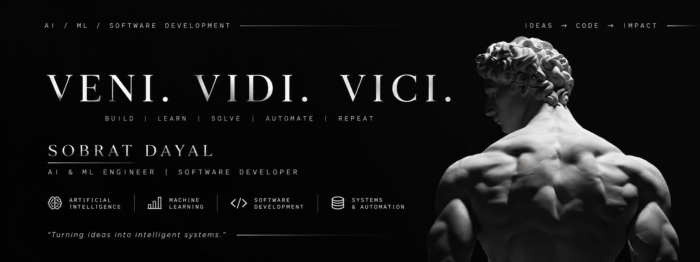
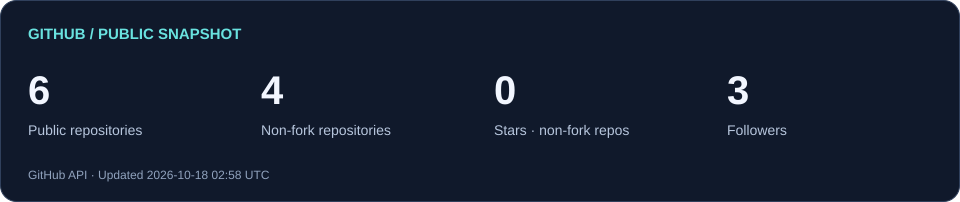
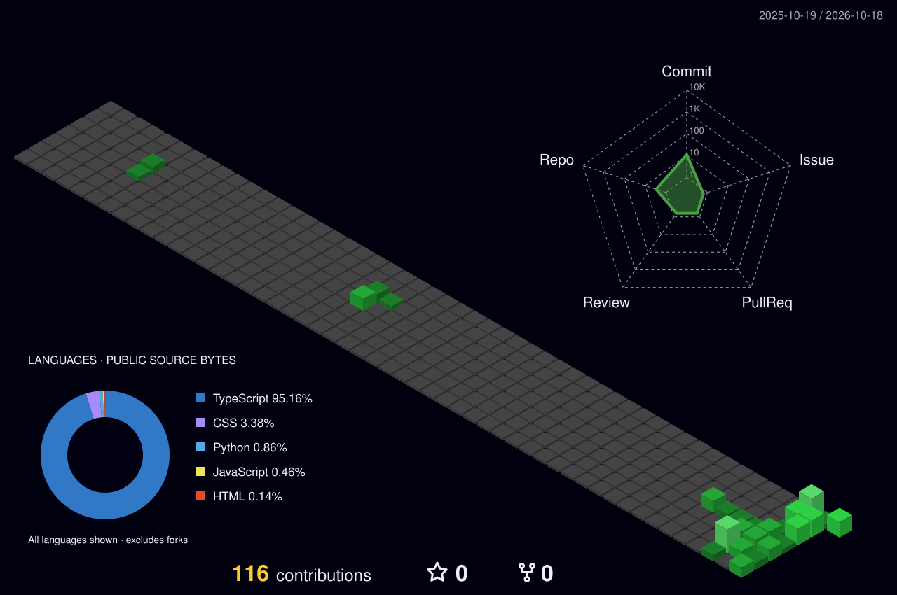

<!-- Profile repository: Sobrat-Dayal/Sobrat-Dayal. See SETUP.md before uploading. -->

  

<h1 align="center">Hi, I'm Sobrat 👋</h1>

Building practical tools for careers, research, and everyday workflows.

  <a href="#about">About</a> ·
  <a href="#tech-stack">Tech stack</a> ·
  <a href="#featured-projects">Projects</a> ·
  <a href="#github-activity">Activity</a> ·
  <a href="#connect">Connect</a>

### About Me

I'm a **Software Engineer and AI/ML Developer** specializing in **Artificial Intelligence, Deep Learning, LLMs, Autonomous Agents, and Systems Engineering**. I focus on architecting scalable, high-performance software, optimizing AI systems, and developing intelligent automation. My work combines **advanced software engineering, applied research, and open-source innovation** to solve complex technical challenges.

## Connect

 
  
  
  
  

[Browse my repositories](https://github.com/Sobrat-Dayal?tab=repositories) · [See my public activity](https://github.com/Sobrat-Dayal?tab=overview)

## Tech stack

<table>
<tr>
<td width="50%" align="center" valign="top">
<h3>🎨 Frontend & UI</h3>

 

</td>
<td width="50%" align="center" valign="top">
<h3>⚙️ Languages, Backend & Databases</h3>

 

 

</td>
</tr>
<tr>
<td width="50%" align="center" valign="top">
<h3>🤖 AI, ML & Data Science</h3>

</td>
<td width="50%" align="center" valign="top">
<h3>☁️ Cloud & DevOps</h3>

 

</td>
</tr>
<tr>
<td width="50%" align="center" valign="top">
<h3>🎨 Design & Creative</h3>

</td>
<td width="50%" align="center" valign="top">
<h3>🧰 Tools, Platforms & Workflow</h3>

 

 

 

</td>
</tr>
</table>

## Featured projects

### 01 · [Athena Career Studio](https://github.com/Sobrat-Dayal/athena-career-studio)

A thoughtful resume, application, and interview workspace built with React and TypeScript.

**React · TypeScript**  
[Explore the repository →](https://github.com/Sobrat-Dayal/athena-career-studio)

---

### 02 · [Research Notebook](https://github.com/Sobrat-Dayal/research-notebook-v2)

A research notebook with Gemini summaries, cited chat, paper imports, and presentation exports.

**TypeScript**  
[Explore the repository →](https://github.com/Sobrat-Dayal/research-notebook-v2)

---

### 03 · [Polyglot](https://github.com/Sobrat-Dayal/Polyglot)

Explore another of my public TypeScript repositories.

**TypeScript**  
[Explore the repository →](https://github.com/Sobrat-Dayal/Polyglot)

## GitHub activity

### Contribution snake

  <picture>
    <source media="(prefers-color-scheme: dark)" srcset="assets/github-contribution-grid-snake-dark.svg" />
    <source media="(prefers-color-scheme: light)" srcset="assets/github-contribution-grid-snake.svg" />
    
  </picture>

### 3D contribution skyline

  

---

<strong>Thanks for stopping by.</strong> Explore a project, read the code, and follow along.

