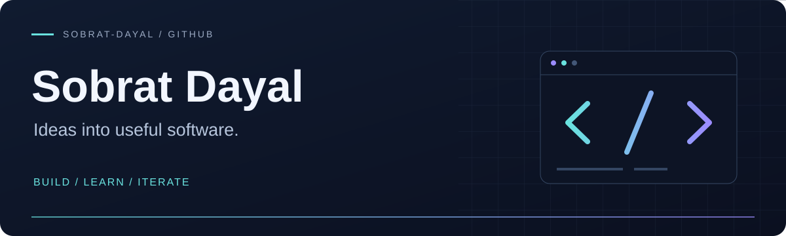

<!-- Profile repository: Sobrat-Dayal/Sobrat-Dayal. See SETUP.md before uploading. -->

  

<h1 align="center">Hi, I'm Sobrat 👋</h1>

Building practical tools for careers, research, and everyday workflows.

  <a href="#about">About</a> ·
  <a href="#tech-stack">Tech stack</a> ·
  <a href="#featured-projects">Projects</a> ·
  <a href="#github-activity">Activity</a> ·
  <a href="#connect">Connect</a>

## About

I'm Sobrat Dayal.

- **Career tools:** resumes, applications, and interview preparation in one workspace.
- **Research tools:** paper imports, AI-assisted summaries, cited chat, and presentation exports.
- **On this profile:** a selection of my repositories and a snapshot of my public GitHub activity.

## Connect

  

[Browse my repositories](https://github.com/Sobrat-Dayal?tab=repositories) · [See my public activity](https://github.com/Sobrat-Dayal?tab=overview)

<!-- Add verified LinkedIn, portfolio, or email links here. None were available in the public GitHub profile when this package was created. -->

## Tech stack

  
  
  
  
  
  

My public repositories contain TypeScript, CSS, JavaScript, Python, and HTML. Athena Career Studio also uses React.

## Featured projects

### 01 · [Athena Career Studio](https://github.com/Sobrat-Dayal/athena-career-studio)

A thoughtful resume, application, and interview workspace built with React and TypeScript.

**React · TypeScript**  
[Explore the repository →](https://github.com/Sobrat-Dayal/athena-career-studio)

---

### 02 · [Research Notebook](https://github.com/Sobrat-Dayal/research-notebook-v2)

A research notebook with Gemini summaries, cited chat, paper imports, and presentation exports.

**TypeScript**  
[Explore the repository →](https://github.com/Sobrat-Dayal/research-notebook-v2)

---

### 03 · [Polyglot](https://github.com/Sobrat-Dayal/Polyglot)

Explore another of my public TypeScript repositories.

**TypeScript**  
[Explore the repository →](https://github.com/Sobrat-Dayal/Polyglot)

## GitHub activity

### 3D contribution skyline

  

---

<strong>Thanks for stopping by.</strong> Explore a project, read the code, and follow along.

